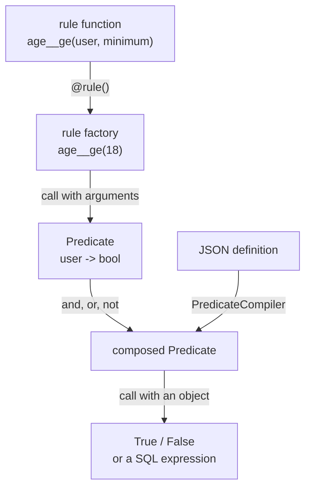

# User guide

pyspecification has a handful of pieces. Each page covers one of them with examples you
can paste and run (every `python` block in these docs is executed by the test suite).

| Piece | What it is | Page |
| --- | --- | --- |
| `Predicate` | a callable `T -> R` that composes with `&`, `\|`, `~` | [Predicates](predicates.md) |
| `object_rule` | turns `fn(obj, *args)` into a factory of predicates | [Object rules](object-rules.md) |
| `subscriptable_rule` | the same for `fn(row, key, *args)` on dicts and lists | [Subscriptable rules](subscriptable-rules.md) |
| `ObjectRulesRegistry`, `SubscriptableRulesRegistry` | a named vocabulary of rules | [Registries](registries.md) |
| `Predicate.failures`, `Failure` | which rules failed, with user-facing messages | [Why a rule failed](failures.md) |
| `Process`, argument errors | converting raw JSON or form values, failing early | [Arguments and processing](arguments.md) |
| `PredicateCompiler` | JSON rule definitions to predicates | [Compiling rules from JSON](compiling.md) |
| `get_*_json_schema` | JSON Schema of rules and whole expressions | [JSON Schema](json-schema.md) |

## The mental model

1. You write a **rule function**. Its first parameter is the object under test; the
   other parameters are the rule's arguments.
2. A decorator turns it into a **rule factory**. Calling the factory checks and binds the
   arguments right away and returns a **predicate**.
3. Predicates **compose** into bigger predicates.
4. Calling a predicate with an object **evaluates** it.

Because arguments are checked in step 2, a typo or a bad value fails while the rule is
being built (for example when an admin saves it), never halfway through filtering a
million rows.

## Naming rules

The docs follow a Django-like convention, `<field>__<operator>`: `age__ge`,
`name__istartswith`, `created_at__between`. It is only a convention, any valid Python
identifier works, but editors built on the [JSON Schema](json-schema.md) use it to offer
the field first and the operator second.
